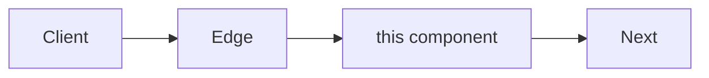
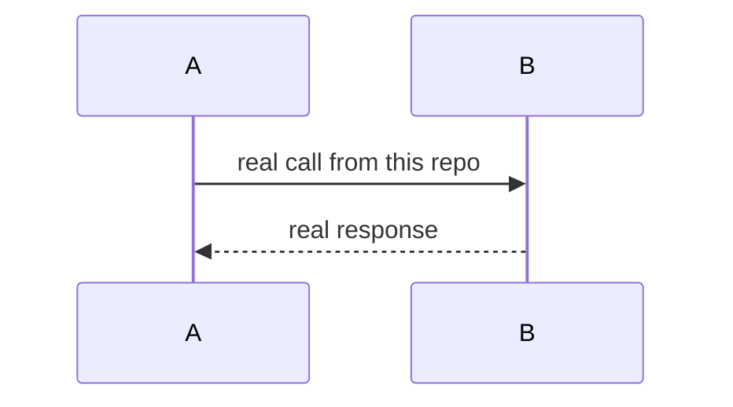

# Page template

Use this shape. Drop a section that does not apply. Keep names from the repo.

```markdown
# <Topic> in this project

<One paragraph: what it is here, which library or tool, and what it is not responsible for.>

Related: [Architecture](architecture.md) · [<sibling>](<sibling>.md)

## What it is

<Short definition a new reader needs. A small table of the constructs that matter in this repo.>

## Where it sits



## Workflow



## How to use

```bash
# command copied from this repo
```

## How to change

1. Edit <source of truth>.
2. Regenerate or recompile with <command>.
3. Update the caller.

## Files

| File | Role |
|------|------|
| `path` | one job |
```

## Diagram pick

| Reader question | Diagram |
|-----------------|---------|
| What talks to what? | `flowchart LR` |
| What happens on one request or job? | `sequenceDiagram` |
| What starts first, or which command? | `flowchart TD` |
| What nests inside a message or schema? | `flowchart TD` with the parent type as the root |
| Which rows reference which rows? | Mermaid `erDiagram` |
| Which status follows which status? | `stateDiagram-v2` |

Prefer one diagram that matches the code over three that repeat it.
